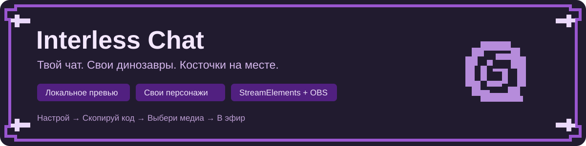

# Interless Chat



[](https://github.com/Interless/interless-twitch-chat/releases/tag/v0.21.1)
[](https://github.com/Interless/interless-twitch-chat/actions/workflows/ci.yml)
[](LICENSE)

**Настраиваемый Twitch-чат с костяными рамками, персональными динозаврами и локальным редактором оформления.** Работает как Custom Widget в StreamElements и Browser Source в OBS. Собственный веб-сервер для установки не требуется.

[Скачать версию 0.21.1](https://github.com/Interless/interless-twitch-chat/releases/tag/v0.21.1) · [Установить](docs/QUICKSTART.md) · [Все настройки](docs/CONFIGURATION.md) · [Решить проблему](docs/TROUBLESHOOTING.md)

## Как это работает

1. Открой `preview.html` из архива релиза, загрузи своих персонажей и настрой оформление.
2. Проверь результат тестовыми сообщениями. Сохрани проект в JSON, чтобы продолжить позже.
3. Четырьмя кнопками скопируй **HTML / CSS / JS / FIELDS** в Custom Widget StreamElements.
4. В настройках виджета выбери файлы персонажей из **медиатеки StreamElements** и сохрани Overlay.
5. Добавь URL Overlay в OBS как источник браузера.

В скопированный код входят оформление, один выбранный шрифт и метаданные персонажей. Анимации загружаются из медиатеки отдельно: их размер больше не раздувает JavaScript и запрос сохранения Overlay. Исходные локальные файлы остаются в JSON проекта.

## Возможности

| Возможность        | Что можно настроить                                                                                              |
| ------------------ | ---------------------------------------------------------------------------------------------------------------- |
| Костяные карточки  | Цвета текста, ника, верхней и нижней плашек, косточек, рамки, разделителя, тени и значков через RGB/HEX          |
| Прозрачность       | Отдельно тело сообщения, плашка имени и фоновые рисунки                                                          |
| Шрифты             | 10 вариантов с кириллицей: пиксельные, обычные, с засечками и рукописные                                         |
| Персонажи зрителей | Свои изображения и анимации, выбор командой в чате, сохранение выбора по Twitch user ID                          |
| Команды            | Переименование в превью и в StreamElements; латиница и кириллица                                                 |
| Масштаб            | Общий ползунок 25–200% в превью и StreamElements; отдельный размер динозавров                                    |
| Сообщения          | Ширина, расстояния, время показа, количество, привязка блока и отступы                                           |
| Движение           | Вход/выход и спокойное плавное, пиксельное или хаотичное покачивание с частотой и размахом                       |
| Фоновые рисунки    | 11 типов, плотность, доля сообщений с декором, частота смены, случайные координаты и повороты, плавное затухание |
| Предпросмотр       | Свой текст, ник и роль; проверки значков, чередования, команд и случайных персонажей                             |
| Сохранение         | JSON проекта с оформлением и локальными медиа; отдельный компактный пресет только с параметрами                  |
| Twitch             | Нативные emotes, значки, удаление сообщений и сообщений пользователя по событиям модерации                       |

### Чередование сообщений

Новые сообщения появляются снизу, предыдущие поднимаются вверх. Компактный блок можно привязать слева, по центру или справа. В режиме чередования **первая плашка находится слева от персонажа, вторая справа, третья слева, четвёртая справа**. Длина сообщения и роль на порядок не влияют. Команды не занимают место в очереди и не переключают сторону.

### Роли и значки

| Роль                        | Стилизованный значок |
| --------------------------- | -------------------- |
| Стример                     | Корона               |
| Главный модератор           | Молоток              |
| Модератор                   | Меч                  |
| VIP                         | Алмаз                |
| Подписчик / обычный зритель | Таракан              |

Оформление выбирается по данным роли в событии Twitch/StreamElements. Дополнительные нативные значки, например значок подписки, сохраняются. Общий переключатель скрывает все значки.

### Свои динозавры

Готовых персонажей в комплекте нет. Выбери папку или отдельные файлы **WebM, MP4, GIF, WebP, PNG или APNG**. Локальный импорт поддерживает до **50 файлов, 16 МиБ на файл и 64 МиБ суммарно**; при загрузке в медиатеку действуют правила самого StreamElements.

Имя `trex.webm` создаёт начальную команду `!trex`. Затем можно изменить её на `!барни` или другую: файл переименовывать не нужно. Старая команда перестаёт работать, а медиа и назначения зрителей остаются привязаны к тому же персонажу. При замене папки новый набор целиком заменяет предыдущий.

Команда меняет персонажа для **следующих сообщений автора**. В превью кнопки выбора сразу обновляют уже показанные сообщения, чтобы удобно сравнивать варианты. По умолчанию используется первый загруженный персонаж; без загруженных файлов чат отображается без пустого места под картинку.

`!dino`, `!ichat` и `!interless_chat` зарезервированы для справки. Чтобы список действительно отправлял бот StreamElements, отдельно настрой его Custom commands; виджет сам сообщения от имени бота не отправляет. [Подробнее о персонажах и файлах](docs/ASSET_GUIDE.md).

## Где менять настройки

| Где                                        | Доступные изменения                                                                               |
| ------------------------------------------ | ------------------------------------------------------------------------------------------------- |
| Локальный `preview.html`                   | Полное оформление, шрифты, расположение, анимации, фоновые рисунки, набор персонажей и их команды |
| StreamElements → «Динозаврики — медиатека» | Выбор загруженного файла и название команды для каждого персонажа                                 |
| StreamElements → «Масштаб чата»            | Общий масштаб без повторного копирования кода                                                     |

После изменения оформления в превью заново скопируй четыре вкладки. **Не очищай DATA** в существующем Custom Widget: там хранится выбор медиа и значения его полей. После обновления проверь выбранные файлы, команды и масштаб.

Изменения, сделанные только в StreamElements, не возвращаются автоматически в локальный JSON. Подробности и примеры: [настройки](docs/CONFIGURATION.md).

## Шрифты и фон

В превью доступны Press Start 2P, Tiny5, PT Sans, Rubik, Comfortaa, Lora, Marck Script, Bad Script, Caveat и Neucha. Все содержат русскую азбуку с Ё/ё, латиницу и цифры. В StreamElements переносится только выбранный WOFF2; загрузка шрифта из внешнего сервиса не требуется.

На фоне сообщений можно включить косточку, книгу, аммонит, геологический молоток, след динозавра, череп, трилобит, папоротник, кисточку, колбу и бутылку пива. Алгоритм учитывает размер плашки и габариты повёрнутых рисунков, оставляет расстояния между ними и ограничивает количество для коротких сообщений. Декор находится под текстом; при смене старый набор плавно затухает.

## Установка и обновление

- **Первая установка:** [пошаговая инструкция](docs/QUICKSTART.md).
- **Переход со старых версий:** [обновление и ошибка 413](docs/TROUBLESHOOTING.md).
- **Новые персонажи:** добавь их в набор превью, скопируй код и выбери медиа в StreamElements. В 0.21.0 свободных дополнительных слотов в панели ещё нет.
- **Резервная копия оформления:** кнопка «Сохранить проект». Пресет JSON содержит только параметры; проект JSON дополнительно содержит локальные анимации.

Полный список изменений по версиям: [CHANGELOG.md](CHANGELOG.md). Обзор текущего релиза: [0.21.1](docs/releases/v0.21.1.md).

## Разработка

Нужны Node.js из [`.nvmrc`](.nvmrc) и npm 11/12. React и TypeScript используются при разработке; для установки готового релиза Node.js не нужен.

```bash
npm ci
npm run dev
```

Проверка и сборка:

```bash
npm run check
```

Команда проверяет форматирование, ESLint, TypeScript, unit/component-тесты, собирает виджет и выполняет DOM-проверки собранного превью и копируемого кода. Проверку изображения, прозрачности видео и эфира в целевом OBS она не заменяет.

После `npm run build`:

- `dist/streamelements/preview.html` — полный локальный редактор;
- `dist/streamelements/` — базовые вкладки виджета, инструкция и лицензии;
- `dist/interless-twitch-chat-v0.21.1.zip` — архив установки;
- `dist/interless-twitch-chat-v0.21.1.zip.sha256` — контрольная сумма.

Для своих настроек используй кнопки копирования **из превью**: базовые `widget.*` не включают твой локальный проект.

[Архитектура](docs/ARCHITECTURE.md) · [Участие в разработке](CONTRIBUTING.md) · [Ручная проверка](docs/QA_CHECKLIST.md) · [Публикация релиза](docs/GITHUB_SETUP.md) · [Планы](docs/BACKLOG.md)

## Ограничения

- Медиатека нужна для файлов эфира; локальная папка не синхронизируется с ней автоматически.
- Сохранение выбора персонажа зависит от доступности localStorage в браузере/OBS; серверной базы назначений нет.
- 7TV, BetterTTV и FrankerFaceZ пока не поддерживаются.
- Если стек выше сцены, старые сообщения обрезаются сверху до удаления по таймеру или лимиту.
- Проверки StreamElements/OBS, которые требуют реального канала и медиатеки, выполняются отдельно по [чек-листу](docs/QA_CHECKLIST.md).

## Лицензия

Код и собственная векторная графика проекта — [MIT](LICENSE). Шрифты поставляются со своими лицензиями OFL в `src/assets/fonts/` и `FONT-LICENSE.txt` внутри релиза. Пользовательские файлы персонажей в репозиторий и стандартный релиз не включены.
