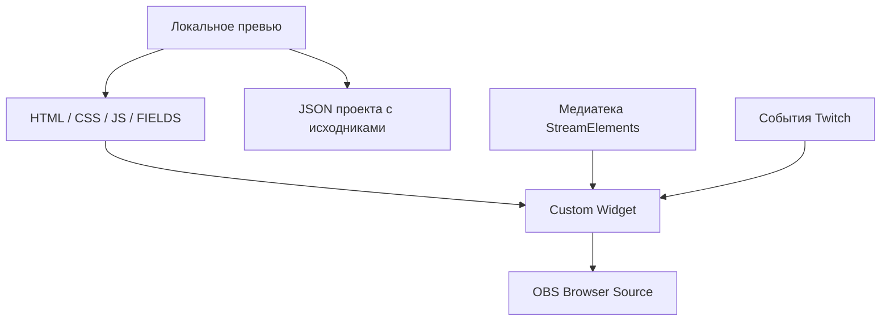

# Архитектура

Interless Chat состоит из локального редактора и исполняемого виджета StreamElements. Они используют одни доменные модули и React-компоненты. Backend проекта отсутствует; файлы для эфира размещаются в медиатеке StreamElements.

## Runtime

`StreamElementsAdapter` читает `onWidgetLoad` и `onEventReceived`. При загрузке он сначала связывает выбранные медиа и команды с метаданными персонажей, затем нормализует конфигурацию. События сообщений и модерации проходят проверку структуры перед передачей reducer.

Поддерживаются listener types `message`, `delete-message`, `delete-messages`. Внешний общий clear-chat listener не выдумывается. `raid-latest` не превращается в постоянную роль рейдера.

`overlayReducer` хранит сообщения, очередь сторон и выбор персонажа по user ID. Принятое сообщение получает свою сторону и ID персонажа. Команды обрабатываются до `hideCommands`, не добавляются в стек и не переключают сторону. Удаление карточки не перенумеровывает стороны оставшихся сообщений.

`MessageLifecycleService` создаёт и отменяет таймеры входа/выхода/удаления. Лимит сообщений ограничивает DOM при длительной работе. `localStorage` сохраняет пары user ID → внутренний ID персонажа отдельно для URL виджета; при недоступном хранилище выбор остаётся в памяти сессии.

## Конфигурация

`configNormalizer.ts` принимает недоверенные данные: проверяет числа, цвета, перечисления и URL, подставляет значения по умолчанию. `preset.ts` сериализует только разрешённые параметры.

Копируемый JS включает снимок оформления. Старые значения Fields/preset существующего виджета не должны подменять этот снимок. Из нативных настроек действуют выбранные медиа, команды и общий `chatScale`; последний специально имеет приоритет над экспортированным масштабом. Остальные настройки меняются в превью и переносятся повторным копированием.

## Персонажи и медиатека

- `characterPack.ts` валидирует набор из 1–50 файлов, команды, размеры и границы кадра. Пустой каталог представлен `null`.
- `folderImport.ts` читает исходные байты локальных файлов и метаданные изображения/видео. Папка не отслеживается автоматически, импорт заменяет набор целиком.
- `characterRegistry.ts` хранит текущие URL и метаданные. Стабильный внутренний ID берётся из имени файла и не меняется при переименовании команды.
- `mediaLibrary.ts` создаёт метаданные и нативные поля `dinoMedia_<id>` / `dinoCommand_<id>`. Base64 исходников в экспорт не включается. Во время `onWidgetLoad` поле с HTTPS URL связывается с персонажем.
- `chatCommands.ts` разрешает новое название в стабильный ID. Старое название не остаётся алиасом. Команды справки зарезервированы; некорректные и конфликтующие нативные названия возвращаются к значениям из превью.
- `RoleCharacter` выбирает image/video по явному типу медиа, включая URL без расширения, помещает его в общий квадрат и использует сохранённые границы кадра. Импорт не восстанавливает качество исходника и не перекодирует его.

Реестр изначально пуст, стандартные динозавры не поставляются. Первый загруженный персонаж используется как fallback. При пустом наборе нет ни изображения, ни зарезервированного места под него. Персональный выбор и назначения по логину имеют приоритет над ассетом роли согласно reducer и resolver.

## Превью и перенос

| Модуль                           | Назначение                                                                 |
| -------------------------------- | -------------------------------------------------------------------------- |
| `scripts/preview-template.html`  | Панели управления, композер сообщений, тестовые сценарии                   |
| `scripts/folder-controller.js`   | Галерея, переименование команд, импорт проекта и четыре кнопки копирования |
| `src/preview/project.ts`         | JSON проекта: пресет и исходные медиа                                      |
| `src/preview/exportPack.ts`      | Подготовка четырёх вкладок с текущими параметрами                          |
| `src/preview/selectedFontCss.ts` | Оставляет в CSS один выбранный `@font-face`                                |
| `scripts/preview.mjs`            | Встраивает общий runtime и полный CSS в локальный редактор                 |

Превью хранит все десять шрифтов WOFF2. В StreamElements переносится один выбранный шрифт, остальные остаются в редакторе. JSON проекта сохраняет исходные анимации, но не загружает их в аккаунт. В runtime нет синхронизации обратно в локальный проект и нет отправки сообщений от имени бота.

Экспорт ZIP через внутренний legacy-helper сохранён для совместимости тестов; основной пользовательский сценарий — копирование кода. Кнопка сохранения проекта скачивает JSON для повторного редактирования.

## Отображение

`MessageLayer` размещает карточки flex-стеком снизу вверх. Привязка блока и чередование плашки/персонажа независимы. Общий масштаб реализован на всём слое с компенсацией логических размеров сцены; отступы от краёв остаются в координатах сцены.

`MessageBubble` задаёт CSS variables темы, размеры и анимации. Векторная костяная рамка и отдельные поверхности позволяют менять цвет и прозрачность. `RoleBadge` отображает стилизованную роль, `UserName` сохраняет дополнительные нативные значки без дублирования значков авторитета.

`MessageDecorations` измеряет область текста через `ResizeObserver`. Алгоритм размещения учитывает габариты повёрнутых рисунков и интервалы. Его случайность воспроизводима для сообщения и поколения. Старый набор затухает перед появлением нового; фоновые рисунки не влияют на размер карточки.

## Сборка и проверки

Vite создаёт IIFE с React внутри. CSS извлекается отдельно; внешних JS-import и React CDN нет. `package-build.mjs` создаёт полный локальный редактор, компактный базовый CSS, базовые Fields масштаба, инструкцию, лицензии, ZIP и SHA-256. Шрифтовые лицензии в копируемый код не вставляются.

`npm run check` выполняет форматирование, lint, TypeScript, unit/component-тесты, сборку и DOM-проверки готового превью/копируемого кода. Автоматические проверки не подтверждают работу конкретного кодека в OBS, реальные разрешения аккаунта или визуальное соответствие в эфире: для этого есть [ручной QA](QA_CHECKLIST.md).

## Границы данных

Текст чата рендерится как текст React, не как HTML. Нативные Twitch media ограничены известными HTTPS CDN. Пользовательские медиа проходят проверку формата и размеров локального пакета или HTTPS URL. У проекта нет серверных секретов, OAuth-клиента, базы пользователей или собственного Twitch-бота. Пользовательские JSON/HAR и медиа не входят в репозиторий и стандартный релиз.
